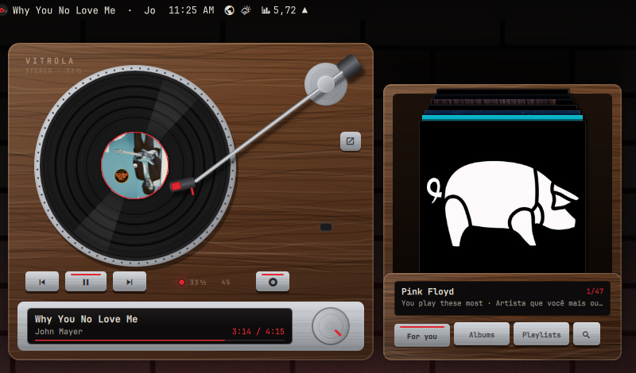

# Vitrola

Plugin do [Omarchy shell](https://omarchy.org) que mostra o Spotify como uma vitrola: madeira, metal escovado e as cores do tema atual.



- **Barra:** um disquinho girando com a música atual.
- **Painel:** toca-discos completo. Arraste o braço para avançar na música, gire o botão para mudar o volume, e o disco é trocado com animação quando a faixa muda. A janela pode ser destacada e ficar flutuando.
- **Caixote de discos:** suas playlists, álbuns, artistas e busca pela Web API do Spotify, para escolher o que tocar.

## Instalação

```bash
omarchy plugin add https://github.com/LoganMerazzi/omarchy-vitrola.git --enable
~/.config/omarchy/plugins/logan.vitrola/extras/install.sh
omarchy restart shell
```

O `extras/install.sh` instala o que fica fora da pasta do plugin:

| Arquivo | Destino | Para quê |
|---|---|---|
| `vitrola-spotify-toggle` | `~/.local/bin/` | mostra ou esconde o app do Spotify |
| `hyprland.lua` | `~/.config/hypr/hyprland.lua` | janela destacada flutuando sem borda; Spotify escondido em `special:spotify` |
| `bindings.lua` | `~/.config/hypr/bindings.lua` | atalho Super+Shift+M |
| `autostart.lua` | `~/.config/hypr/autostart.lua` | abre o Spotify escondido no login |

## Requisitos

- O **app oficial do Spotify**, que é quem toca o som. O controle é feito por MPRIS e o volume pelo stream `spotify` do PipeWire.
- Para o caixote de discos, um **app de desenvolvedor do Spotify** criado em <https://developer.spotify.com/dashboard>:
  - Redirect URI: `http://127.0.0.1:8977/callback`
  - API: Web API
  - Depois, faça login uma vez em cada máquina:
    ```bash
    python3 ~/.config/omarchy/plugins/logan.vitrola/spotify.py login <client_id>
    ```
  - O token fica em `~/.local/state/vitrola/token.json`, fora do repositório. O login usa PKCE, então não precisa de client secret.

Limitações do modo de desenvolvimento do Spotify: só é possível listar as faixas das playlists que são suas, não existe API de recomendações e "top tracks" de artista não está disponível (o plugin usa a discografia no lugar).

## Atualizar

```bash
omarchy plugin update logan.vitrola && omarchy restart shell
```

Edições nos arquivos deste plugin só aparecem depois de `omarchy restart shell`.

## IPC

```bash
omarchy-shell logan.vitrola state
omarchy-shell logan.vitrola detach
omarchy-shell logan.vitrola seekPercent 50
omarchy-shell logan.vitrola setVolume 40
```
